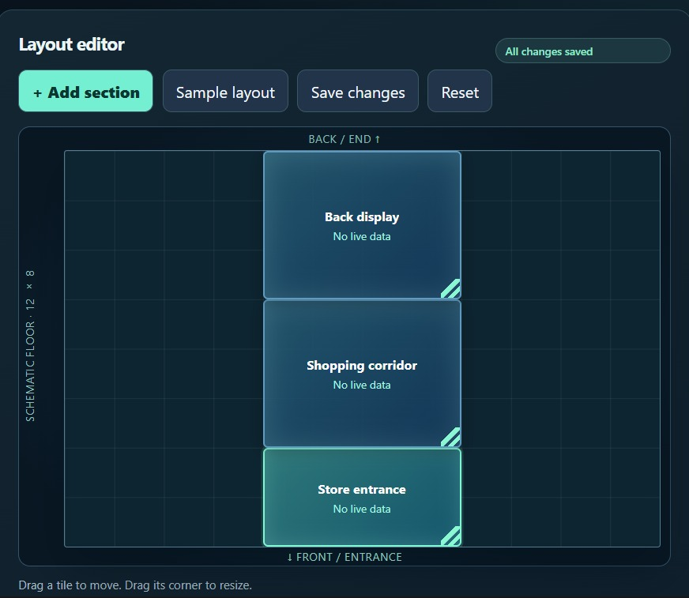
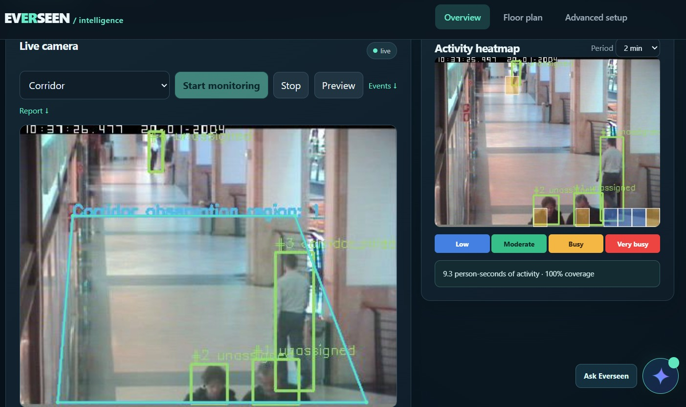
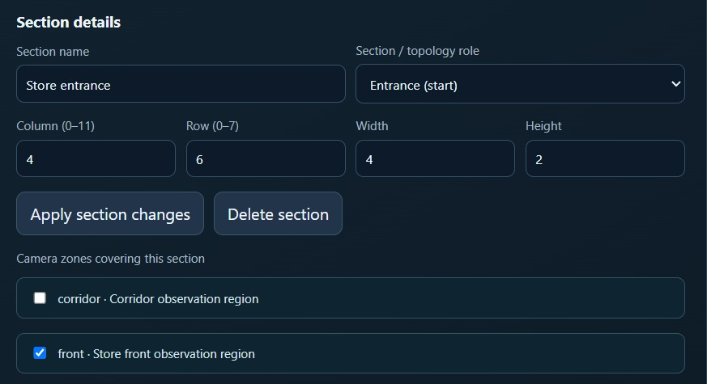
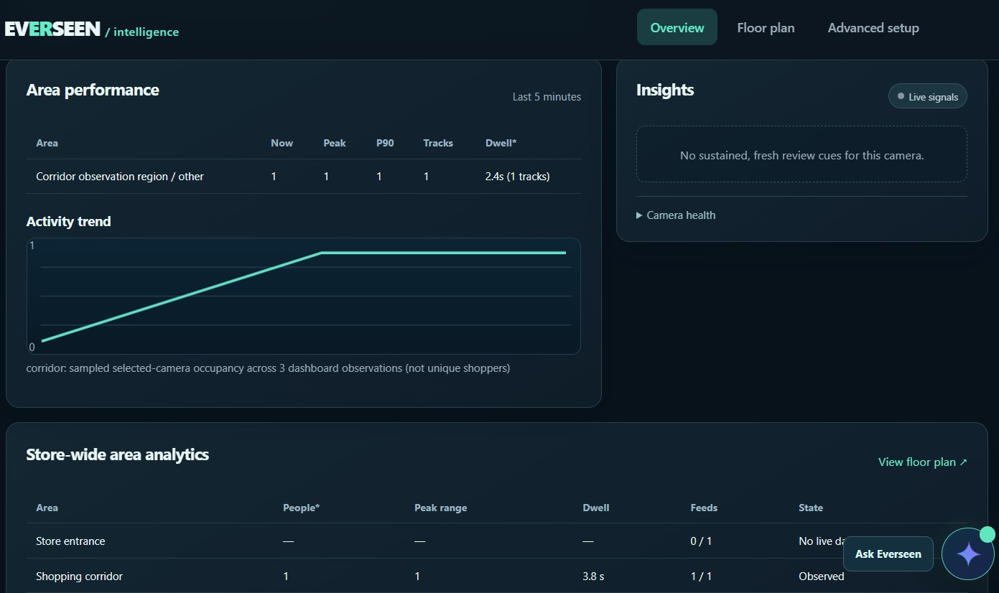
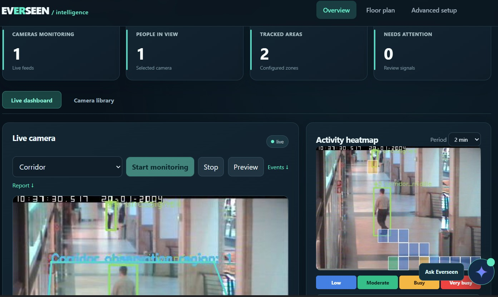
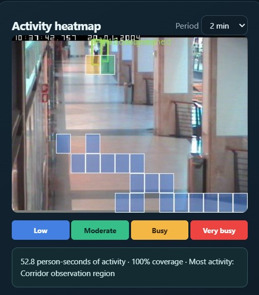
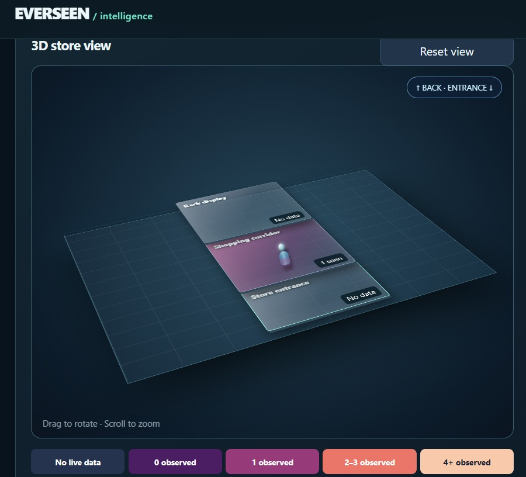
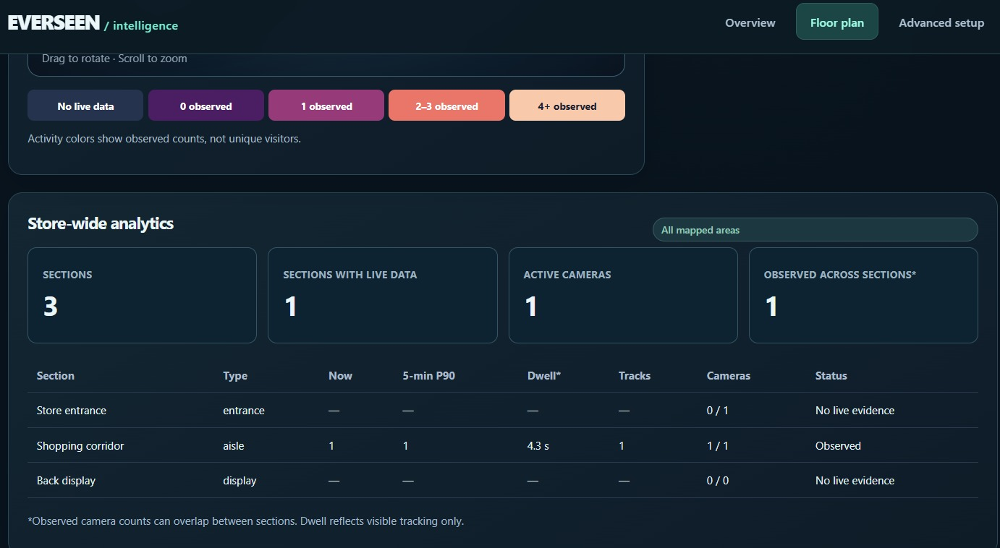
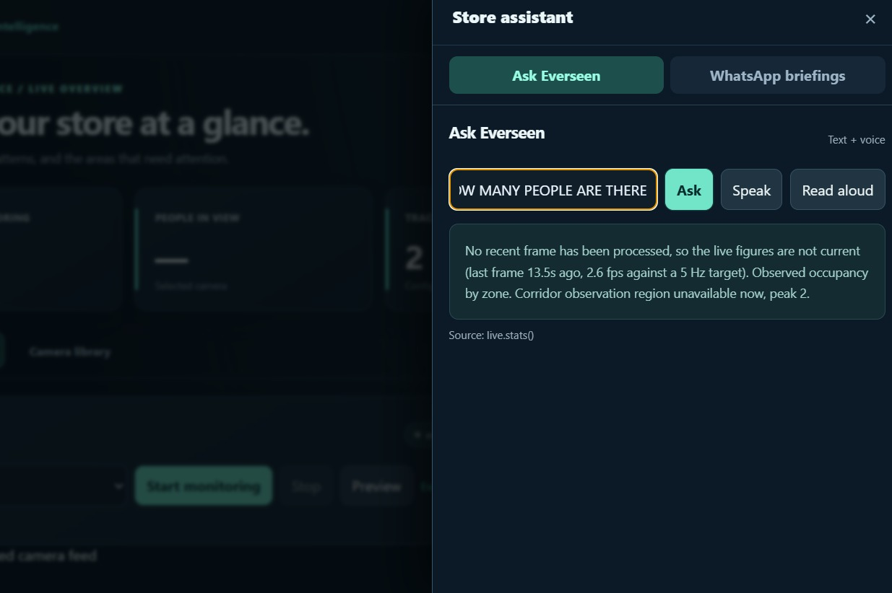

# Everseen — Retail Spatial Intelligence

**Camera analytics, a live floor plan and an evidence-backed store assistant, in one local application.**

Everseen helps store managers see where activity is happening, how long visitors are visibly present, and which areas deserve attention. Configure cameras and floor zones, view a rotatable occupancy-aware store layout, and ask operational questions in plain English. All analysis runs locally by default; no customer identification or cloud processing is required.

## Get started

**Python 3.12** and an internet connection are needed for the *first* model/dataset download. The web app runs on Windows, macOS or Linux; the commands below show Windows PowerShell.

```powershell
git clone https://github.com/JustATalentedGuy/EverseenHackathon.git
cd EverseenHackathon
py -3.12 -m venv .venv
.\.venv\Scripts\python.exe -m pip install -r requirements.txt
.\.venv\Scripts\python.exe scripts\setup_demo.py --data
.\.venv\Scripts\python.exe -m prototype.server
```

Open **http://127.0.0.1:8791**. The first run seeds a two-camera CAVIAR demo and its matching example floor plan. The evaluated detector weights and CAVIAR research footage are downloaded separately; third-party data and model weights are not committed. The project includes the original source URLs and research attribution.

## Start using your store

The easiest way to set up Everseen is to **build your floor plan first, then connect your cameras to it**:

1. **Draw the store:** Open **[Floor plan](http://127.0.0.1:8791/layout)**. Click **+ Add section**, drag and resize each box, give it a name (such as *Entrance*, *Aisle*, or *Checkout*), and click **Save changes**.
2. **Set up cameras:** On **[Overview](http://127.0.0.1:8791)**, open **Camera library** to add a camera or video. Return to **Live dashboard** and select a camera. Its picture appears automatically; **Manage camera zones** is already open so you can draw the areas visible in that camera.
3. **Connect cameras to the floor plan:** Go back to **Floor plan**. Select each section and tick the camera zone that covers it under **Camera zones covering this section**. Click **Save changes** again.
4. **Start monitoring:** Return to Overview, select a camera and click **Start monitoring**. Check **Area performance**, the **Activity heatmap**, and **Insights**. The floor plan shows mapped counts and a rotatable 3D view as fresh camera observations arrive.
5. **Decide what to check:** Review repeated busy areas, compare quieter sections, and confirm the situation in the video before moving a display or changing staff assignments. Use **Ask Everseen** for questions or prepare a **WhatsApp briefing** that you send yourself.

**New to the app? Continue to the [full shopkeeper guide](#shopkeepers-step-by-step-guide) below.** It includes floor-plan examples, camera-zone mapping, explanations of every metric, daily checklists, and common fixes.

Changes to cameras, recipients and floor layouts are stored in **Git-ignored, machine-local files**, preserving the documented sample configurations for every clone.

## Shopkeeper's step-by-step guide

This guide shows how to set up your store in Everseen, watch activity, and use the results to make better day-to-day decisions. You do not need to know how the AI works to use the application.

### What you will set up

Everseen connects three things:

1. **Floor sections:** Places in your shop, such as Entrance, Grocery Aisle, Checkout, and Back Display.
2. **Camera zones:** The part of each camera's picture that shows one of those places.
3. **Live observations:** People seen in those camera zones, how long they remain visible, and areas you may want to check.

**The order is: draw your floor plan → add cameras and mark their zones → link the zones to floor sections → start monitoring → review and act.** You can explore a sample floor plan before connecting any cameras.

### 1. Open Everseen

If Everseen has already been installed, start its server and open **http://127.0.0.1:8791** in your browser.

For a first-time setup on Windows, follow the installation commands in the [Get started](#get-started). You can use the included demonstration footage before connecting your own cameras.

At the top of the application you will see:

| Page | What it is for |
|---|---|
| **Overview** | Monitor cameras, check activity, view alerts, and ask Everseen questions. |
| **Floor plan** | Draw your shop, link cameras to sections, and view the 3D layout and suggested actions. |
| **Advanced setup** | Optional tools for recorded video and camera setup. Most daily tasks do not need this page. |

### 2. Create your floor plan

1. Open **Floor plan** at **http://127.0.0.1:8791/layout**.
2. In **Layout editor**, click **+ Add section**. A new box appears on the grid.
3. **Drag** the box to its position in your shop. **Drag its bottom-right corner** to change its size.
4. Click the box. Under **Section details**, enter a clear **Section name**, such as *Billing Counter*, *Snacks*, or *Entrance*.
5. Select the **Section / topology role** that best matches it: Entrance, Exit / back, Aisle / walkway, Checkout, Display / shelving, or General area.
6. Click **Apply section changes** to keep any name, role, or size changes made in the fields.
7. Add the other sections and click **Save changes** when the layout looks right.

The grid has **12 columns and 8 rows**. Sections cannot overlap. You can use **Sample layout** to see an example, but it **replaces your current layout in the editor**; save anything important first. **Reset** brings back your last saved layout.

#### Which side is the entrance?

The **bottom** of the editor represents the front/entrance. The **top** represents the back of the store. Set an area to *Entrance* or *Exit / back* if you want to identify these places yourself.

Sections touching along an edge help Everseen understand which areas are next to each other. This is a simple floor-plan model: **you should still check that a real walkway or doorway connects them**.

#### Simple floor-plan example

| Front of store | Middle | Back of store |
|---|---|---|
| Entrance | Grocery Aisle | Back Display |
| Checkout | Snacks | Storage / Other |

This is just an example, not a required arrangement. Use the layout that makes sense for your shop.



*Figure: Layout editor with the floor sections drawn.*

### 3. Add cameras and mark the areas they can see

Before a floor section can show people counts, it needs to be connected to a zone from a camera.

#### Add a camera

1. Return to **Overview** and select the **Camera library** tab.
2. Under **Add camera**, enter a friendly name, such as *Entrance Camera*.
3. Enter a usable camera or video source: a direct **RTSP/HTTP video stream**, a **local video file**, or a webcam number such as `0`.
4. Click **Add source**. Repeat for any other cameras you need.

You can also select a validated video from **Video library** when available. A normal YouTube or video-platform webpage link is **not** the same as a playable camera/video URL.

#### Draw a camera zone

1. Go back to the **Live dashboard** tab on Overview.
2. Pick a camera from the selector. Its picture loads automatically. **Preview** refreshes it if needed.
3. **Manage camera zones** is always open; you do not need to expand anything.
4. Click **Draw new zone**, then click at least **three points** around a floor area visible in the picture.
5. Enter a **Zone name**, for example *Checkout Zone*. Pick its **Area type**.
6. Set the **Review threshold** to the number of observed people that should make this area worth checking. For example, set `4` for a small checkout space you want to watch closely.
7. Click **Save shape**. Repeat for other visible areas and cameras.

**Important:** Draw a boundary around the area people actually stand or walk on. Avoid including unrelated spaces or overlapping zones unnecessarily. A camera can cover several zones. If you change and save camera zones while monitoring, active sessions stop; start monitoring again afterward.



*Figure: Live camera with a drawn camera zone and the activity heatmap.*

### 4. Map camera zones to the floor plan

This is the step that connects your video to your store layout.

1. Open **Floor plan** again.
2. Click a floor-plan section, such as *Checkout*.
3. Under **Camera zones covering this section**, tick the camera zone that actually shows it, such as *Checkout Camera · Checkout Zone*.
4. If two cameras both look at the same section, you may tick zones from **both cameras** for that section.
5. Repeat for each section, then click **Save changes**.

**Mapping rule:** A particular camera zone can be linked to **only one floor-plan section**. If you need separate sections, first draw separate camera zones that match them. Do not link an entrance camera zone to a shelf area it cannot see.

If the floor plan says **No live data**, the section may not have a mapped camera zone, its camera may not be running, or the camera may not yet have fresh observations. That is **not** the same as saying nobody is there.



*Figure: Section details with a camera zone linked to the section.*

### 5. Start monitoring your shop

1. On **Overview → Live dashboard**, select a camera.
2. Click **Start monitoring**.
3. Wait for the first analyzed frames to appear. The picture will show people being detected and tracked.
4. Repeat for the other cameras you want to monitor.
5. Check the **Floor plan** page to see the latest measurements on the mapped sections.

The current local prototype allows **up to four cameras to run analysis at the same time**. You can configure more camera sources and run them in groups. Video playback and real-time analysis speed depend on the computer.

When you finish, click **Stop**. Use **Report ↓** to export a zone report as CSV, or **Events ↓** to export the camera's observation log when available.



*Figure: Area performance, activity trend and store-wide analytics while monitoring.*

### 6. Understand the Overview dashboard

#### Top summary

| Display | What it means |
|---|---|
| **Cameras monitoring** | How many camera sessions are active. |
| **People in view** | Observed people in the selected camera's configured zones. This is **not** the number of unique shoppers in the whole store. |
| **Tracked areas** | Number of camera zones you have configured. |
| **Needs attention** | Current camera-based review signals. A signal asks you to inspect an area; it does not prove a problem. |

#### Area performance

| Metric | Simple meaning | How to use it |
|---|---|---|
| **Now** | People currently observed in that camera zone. | See where activity is concentrated right now. |
| **Peak** | Highest observed count during the current monitoring session. | Notice short busy periods. |
| **P90** | A count that about 90% of the recent recorded samples are at or below. | Look for areas that stay busy often, not just for a moment. |
| **Tracks** | Tracking entries seen by this camera. | Understand observed movement, **not** count unique customers. A person may get a new tracking ID if tracking is lost. |
| **Dwell** | Average time people were **visibly tracked** in that zone. | Compare areas where people tend to remain longer. It is **not** a complete store visit or exact customer wait time. |

The **Activity trend** shows how observed occupancy changes over time. Give the system time to collect enough observations before comparing areas.

#### Activity heatmap

The heatmap shows where tracked people have been **observed spending time in the camera picture**. Choose **30 sec**, **2 min**, or **5 min** to change the period.

- **Low / cool colors:** Less confirmed observed presence in that part of the picture.
- **Busy / warm colors:** More confirmed observed presence during the selected period.
- **Coverage:** How much of the period had enough consecutive camera observations to calculate activity. **Low coverage means some activity may be missing.**

The heatmap shows *observed time in image areas*, not exact customers per square metre. A stationary person can make an area warmer. Red does not automatically mean there is a queue.

#### Insights and camera health

The **Insights** panel highlights sustained patterns that might need attention. Open **Camera health** if the data looks wrong, the feed is slow, or recommendations are missing.



*Figure: Overview summary cards, live camera and activity heatmap.*



*Figure: Activity heatmap with the 2 min period selected.*

### 7. Use the 3D floor plan and store-wide analytics

Open **Floor plan** after cameras are running.

- The **3D store view** shows your saved sections as tiles. **Drag** the view to rotate it and **scroll** to zoom. Click **Reset view** to return to the starting angle.
- Colors reflect the current **observed count for each section**. Grey means no fresh data, not an empty section.
- The small person figures illustrate the observed count. If there are too many figures, the view uses a **+ number** rather than drawing every person.
- The **Store-wide analytics** table shows sections, current counts, recent activity, partial dwell, linked camera feeds, and data status.
- The **Suggested actions** panel offers areas to check. You can click **Inspect section** to focus on the section in the editor.

If several cameras cover the same section, Everseen uses the **highest fresh camera count**, rather than simply adding them. This helps reduce double-counting, but the system **does not identify the same shopper across cameras**. Do not treat the store-wide sum as a verified unique visitor total.

The floor-plan connections help suggest nearby sections, but they cannot tell whether there is a shelf, wall, or blocked passage. Check the real layout before acting.



*Figure: 3D store view with observed counts.*

### 8. Turn observations into decisions

Here is a practical way to use Everseen during a shift:

| What you notice | What to check | Possible next step |
|---|---|---|
| Checkout stays busy | Live video, count trend, available staff, actual line | Consider opening another counter or helping at checkout. |
| One aisle stays crowded | Heatmap, aisle width, whether people are stopping or passing through | Check for a blocked walkway or product display. |
| A display section has little observed activity | Camera coverage, time of day, section visibility | Review product placement; do not assume the area is unpopular from one short sample. |
| Everseen suggests another section for a display | Both sections' live data and whether the sections are connected in the real shop | **Trial** a movable display, watch the next results, and keep the change only if it helps. |
| A section shows no data | Camera running? Zone linked? Recent frames available? | Fix the setup before deciding that the section is empty. |

**A good decision has three steps:** (1) notice a repeated pattern, (2) check the camera and real-world situation, (3) try a small change and compare later observations. Recommendations are **suggestions for review**, not automatic instructions.



*Figure: Store-wide analytics table with section status.*

### 9. Ask Everseen questions

On Overview, click the **Ask Everseen** button near the bottom-right corner.

You can ask questions such as:

- “How many people can the checkout camera see now?”
- “What does visible dwell time mean?”
- “Which areas have review signals?”
- “What should I check before moving a display?”

Everseen answers using available observations and its supporting information. **If a camera has no fresh data, it cannot reliably answer a live-count question.** Text questions work without setting up a cloud AI service. Voice options depend on your browser and configuration.



*Figure: Ask Everseen answering a question about the camera.*

### 10. Prepare a WhatsApp manager briefing

1. Open **Ask Everseen**, then select **WhatsApp briefings**.
2. Under **Recipients**, add a manager's **Name** and WhatsApp number in international format (for example, `+91…`).
3. Choose a **Frequency**, or use **Pause** to stop scheduled briefing preparation.
4. Click **Send now** to prepare a summary immediately.
5. Select **open WhatsApp with the message ready**, check the recipient and message, and **press Send in WhatsApp yourself**.

The app prepares the message and link. It does **not** automatically send or prove delivery. You may also copy the message. Do not share store-camera details with people who should not receive them.

### 11. Quick daily checklist

**Before opening:** Check cameras, confirm the floor sections and camera-zone links are still correct, and start monitoring the feeds you need.

**During the day:** Look at busy areas and activity trends, review sustained signals, and check the video before taking action.

**Before closing:** Export reports if needed, prepare a manager briefing, and stop camera sessions you no longer need.

### 12. If something is not working

| Problem | What to try |
|---|---|
| **Camera preview does not load** | Check the camera address, webcam access, or local video file. Use a direct video stream, not a webpage URL. |
| **No camera zones appear under a floor section** | Open Overview, select the camera (its preview loads automatically), draw and save its zones, then return to Floor plan. |
| **A mapping will not save** | Check for overlapping floor boxes or a camera zone already linked to another section. |
| **Floor-plan changes disappeared** | Make sure you clicked **Save changes**. **Reset** discards unsaved edits. |
| **Counts or the 3D view show no data** | Start the mapped camera and wait for analyzed frames. Check **Camera health** and the camera-zone link. |
| **A heatmap looks empty** | Wait for enough consecutive observations; check coverage and whether people are visible. |
| **No suggested actions appear** | That can be normal. Everseen needs fresh and sustained evidence before showing most recommendations. |
| **Only some cameras will run at once** | The local prototype supports up to four simultaneous analysis sessions. Stop an unused one before starting another. |

### A note about privacy and accuracy

Only use cameras and footage you have permission to access. Everseen measures **camera observations**, not who a person is or what they buy. Counts can miss people when a camera view is blocked, tracking breaks, or processing slows down. Use the dashboard to help you notice patterns—**not as the only reason for a staffing or layout decision**.

For installation and project details, return to [Get started](#get-started). For the underlying technical calculations, see [Technical Implementation](docs/TECHNICAL.md).

---

## Features at a glance

| Feature | Implementation |
|---|---|
| Person tracking | YOLO11n + ByteTrack; camera-scoped identities |
| Occupancy and dwell | Person-box foot point in user-defined zones; **partial visible dwell**, not whole visits |
| Heatmap | Observed person-time per image tile with fixed colors and coverage estimate |
| Multi-camera sections | Explicit zone mapping; highest fresh overlapping camera count, **not** a duplicate-free store total |
| Topology | Internal adjacency and entrance-to-back routes from the editable schematic grid |
| Store recommendations | Human-review prompts, requiring sustained crowding and measured low activity elsewhere |
| Store assistant | Evidence-gated deterministic answers, optional local/cloud *phrasing* and voice |
| Briefings | Scheduled preparation and manual WhatsApp hand-off |
| Live sources | Camera/video/RTSP/HTTP(S); CPU prototype supports four concurrent inference streams |

### Important boundaries

This is a hackathon prototype, **not** validated retail decision-making software. It does not infer purchases, identify shoppers, measure verified unique store footfall, or establish true checkout wait times. Overlapping camera views are not automatically deduplicated. The drawn layout is a schematic until calibrated to a physical floor. “Crowding” and “low-use” recommendations are hypotheses to inspect, not proven causes or profitable department swaps.

## Testing and implementation

```powershell
.\.venv\Scripts\python.exe -m pip install -r requirements-research.txt
.\.venv\Scripts\python.exe -m pytest -q tests
```

See the [shopkeeper guide](#shopkeepers-step-by-step-guide) on this page for everyday use, [Implementation & evidence](docs/TECHNICAL.md) for architecture, formulas and evaluation, and [Operations & sources](docs/OPERATIONS.md) for advanced configuration and dataset information. The original research history and numeric evaluations remain in `research/` and `experiments/` as an auditable appendix.

© Everseen hackathon team — research prototype. No claim of independently validated deployment accuracy.
