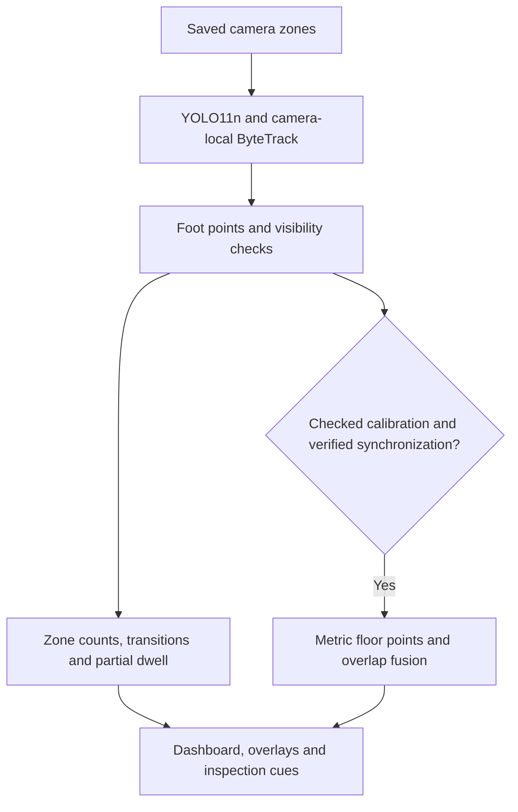

# Everseen: Final Project Documentation
## From feasibility research to the working prototype

**Updated: 7 October 2026**

**Project:** C:\Coding\ML\Everseen

**Final decision:** use camera-local zones for immediate deployment, and upgrade to geometry-first shared-floor analytics when calibration and synchronization pass checks. Keep the pretrained detector as the current default, retain supervised adaptation as a challenger, and leave global identity repair and forecasting as research extensions.

This document follows the progression of the work: what question each stage answered, how it was tested, what the numbers showed, and how that changed the design.

## 1. The problem and the first design principle

The goal is to turn CCTV footage into useful observations: where people gather, how they move between sections, how long they remain visible, and which crowded regions need attention.

That requires four different abilities:

1. **Detection:** find a person in an image.
2. **Local tracking:** keep a temporary ID while that person remains in one camera.
3. **Spatial mapping:** assign their feet to a section or a shared floor position.
4. **Cross-camera association:** decide whether two track fragments belong to the same person.

These stages fail differently. Missing a person affects counts; changing their ID affects individual dwell; counting the same person in two cameras inflates occupancy.

**Design consequence:** occupancy and spatial activity should remain useful even when identity continuity is uncertain. Complete journeys and waiting times need stronger identity evidence than instantaneous counts.

### Reading the metrics

| Metric | Plain meaning | Preferred direction |
| --- | --- | --- |
| Precision / recall | How many reported matches are correct / how many true targets are recovered | Higher |
| F1 | Balances precision and recall: 2PR/(P+R) | Higher; maximum 1 |
| IDF1 | Rewards keeping the correct identity across observations | Higher |
| B-cubed F1 | Rewards identity clusters that contain one person's fragments and recover their history | Higher |
| MOTA | 1 minus misses, false positives and ID switches, divided by annotated person observations | Higher |
| MAE | Average absolute error; for example, 0.84 means 0.84 people of count error per sampled image | Lower |
| Projection error | Distance between estimated and reference floor position | Lower; centimetres/metres |
| ROC-AUC | Ability to rank future positives above negatives; 0.5 is chance | Higher |

**IoU** measures box overlap: intersection area divided by union area. CAVIAR detection matches require IoU >= 0.5. F1 scores for detection, handoff, fusion and congestion measure different tasks; compare them within the same experiment. Dwell errors also have experiment-specific definitions.

## 2. Data strategy: choose evidence for the question

Early research narrowed the dataset shortlist to footage with useful geometry, timing and identity information. No single available dataset answered every question.

| Data actually used | Scale in our experiments | What it established |
| --- | --- | --- |
| MOT17-11 video | 900 frames, 9,436 annotated person observations | Detector/tracker feasibility in a moving-camera mall scene |
| EPFL samples | Calibration checks, small video and appearance-crop checks | Pipeline integrity; not reliable retail/ReID accuracy |
| CITIC-MTMC | Three captures, two people each, five cameras | Indoor topology and controlled fragmentation/handoff |
| WILDTRACK | Seven cameras, 50 annotated frames, 4,443 camera observations; no RGB processed | Floor projection and overlap fusion |
| PhysicalAI Warehouse | Synthetic world trajectories: 60 people, 300 sampled times, 16,529 person states | Congestion-proxy recovery and exploratory forecasting |
| CAVIAR shopping footage | Ten clips, five scenarios, 8,540 decoded frames | Real-video adaptation and camera-zone prototype evaluation |
| MMPTRACK Retail | Access requested; no data received | Desired retail benchmark remains unavailable |

Three evidence levels must remain distinct: **real-video inference**, **annotated-input geometry**, and **controlled/synthetic stress**. A high score on accurate annotated positions does not prove the detector can produce those positions in a store.

CAVIAR was initially unsuitable as the main calibrated MTMC benchmark. It became the deadline fallback for a narrower question: can accessible shopping video support detection, local tracking and manually configured zones? It does not replace WILDTRACK geometry evidence or unavailable MMPTRACK retail validation.

## 3. Stage 1: establish feasibility and check data integrity

### Could ordinary pretrained models track people?

YOLO11n was run with ByteTrack and BoT-SORT on MOT17-11. Preview video was half the annotation resolution; predictions were scaled by two before scoring.

| Tracker | MOTA | IDF1 | ID switches | Missed person observations |
| --- | ---: | ---: | ---: | ---: |
| ByteTrack | 0.528 | 0.530 | 30 | 3,791 |
| BoT-SORT | 0.540 | 0.545 | 26 | 3,681 |

**Finding:** BoT-SORT was slightly better here, but detector misses were the larger problem. This moving-camera result did not justify assuming either tracker solved fixed-store tracking. ByteTrack later became the evaluated prototype baseline; its choice is provisional, not a universal superiority claim.

### Could supplied geometry and appearance labels be trusted?

EPFL and PhysicalAI homography checks verified numerical projection/round trips. Such a check verifies transformation mechanics, not physical accuracy. PhysicalAI's image-to-global coordinate convention remained unresolved; later congestion experiments used supplied world trajectories directly.

An ImageNet ResNet-50 appearance baseline exposed **41 byte-identical crop collisions with different identity labels** in the EPFL demonstration data. Its attractive ReID score was rejected.

**Decision:** validate coordinates and labels before accepting accuracy. Do not rely on appearance alone to join people across cameras.

## 4. Stage 2: compare three architectures

A **tracklet** is a short, continuous track fragment. Association joins fragments only when the evidence supports continuation.

| Architecture | Simple explanation | Advanced mechanism | Main tradeoff |
| --- | --- | --- | --- |
| **A1: section-first** | Match movement between rooms/sections | Topology, transition-time priors, short-gap repair and optional appearance | Useful when geometry is weak; less precise spatial evidence |
| **A2: geometry-first** | Match simultaneous or consecutive observations by floor position | Calibrated projection, overlap deduplication, velocity and topology constraints | Strong with healthy geometry; vulnerable to timing/calibration errors |
| **A3: global graph** | Choose compatible links jointly across many fragments | Weighted graph/path-cover assignment, one predecessor/successor, ambiguity rejection; separate forecast model | More complexity; may leave too many true continuations split |

The tested graph was a hand-engineered matching model, not a trained graph neural network.

### A1: topology helps, but sparse tests are optimistic

CITIC world paths were split into fragments and camera ownership was simulated. Transition-time priors used the other two captures when evaluating a held-out capture.

At reported operating points, time-only handoff achieved **F1 0.941 with two false merges**; topology plus time achieved **0.985 with zero false merges and one false split**, among 34 eligible true handoffs. The thresholds differed, so this describes the measured operating-point tradeoff.

With ten injected cuts/minute, raw-fragment dwell MAE fell from **24.38 s to 3.94 s** after local repair and handoff. Occupancy MAE stayed **0.0384 people**: joining IDs improved histories without adding missing observations.

A separate 12-second CITIC Showroom video run had count MAE **0.390 people/frame**, and **92.52%** of detected foot points projected inside official visibility. CITIC lacked image-box/ID ground truth, so detector F1 and IDF1 were not claimed for that clip.

**Decision:** topology is valuable for constraining candidate links; sparse two-person results cannot establish crowded-store identity accuracy.

### A2: geometry works well when its inputs are correct

On WILDTRACK annotations, median projection error was **11.15 cm**, section accuracy **97.43%**, and fused median error **9.72 cm**. Controlled fragment repair improved from **18.88%** top-1 accuracy using time alone to **97.96%** using geometry plus velocity.

| WILDTRACK condition | Overlap fusion F1 |
| --- | ---: |
| Clean annotated inputs | 0.998 |
| Injected 5-pixel foot-point noise | 0.827 |
| Injected 4-pixel calibration-anchor noise | 0.760 |
| Injected 1-second timestamp error | 0.708 |

Clean fusion removed **99.88%** of duplicate excess observations at the tested 0.75 m threshold. This was annotated-input evaluation, not an RGB detector benchmark.

**Decision:** prefer shared-floor geometry, but check calibration and synchronization before trusting fusion.

### Fairer comparison: identical corrupted inputs

Six real CITIC paths were time-shifted to create concurrent visitors. All methods received identical fragments, with injected misses, position/timing errors and **synthetic appearance embeddings**. Each condition used 30 seeds.

| Condition / metric | A1 | A2 | A3 |
| --- | ---: | ---: | ---: |
| Clean: B-cubed F1 | 0.843 | **0.954** | 0.927 |
| Moderate corruption: B-cubed F1 | 0.534 | **0.669** | 0.509 |
| Appearance unreliable: B-cubed F1 | 0.297 | **0.597** | 0.364 |
| Geometry unreliable: B-cubed F1 | **0.493** | 0.325 | 0.269 |
| Severe mixed corruption: B-cubed F1 | **0.209** | 0.199 | 0.148 |
| Clean: mean section-dwell L1 error, seconds | 6.73 | **2.68** | 3.39 |
| Moderate: mean section-dwell L1 error, seconds | 40.65 | **28.60** | 52.14 |

These are controlled architecture comparisons, not learned ReID scores. Thirty seeds measure variation in injected errors on the same source paths, not generalization to thirty stores.

**Decision:** A2 is the preferred calibrated design; A1 provides the fallback. A3 did not justify its extra complexity. Under severe corruption, every identity score was poor, so aggregate observations are safer than complete journey claims.

## 5. Stage 3: test downstream congestion and forecasting

A crowded region is not automatically a bottleneck: shoppers may be browsing. The PhysicalAI experiment therefore combined occupancy, speed loss, net accumulation, mixed movement directions and persistence into a **defined congestion proxy**.

Occupancy counts people; inflow minus outflow measures accumulation. A conservation check compares occupancy change with that net flow. Disagreement can flag unreliable observations, but agreement alone does not prove accuracy.

| Corruption | A1 proxy F1 | A2/A3 proxy F1 | A1 occupancy MAE | A2/A3 occupancy MAE |
| --- | ---: | ---: | ---: | ---: |
| Mild | 0.837 | 0.834 | 0.114 | **0.099** |
| Moderate | 0.508 | 0.494 | 0.287 | **0.243** |
| Severe | 0.050 | 0.049 | 0.543 | **0.501** |

A2/A3 shared the same deduplication layer here, explaining identical scores. Geometry improved counting without winning every proxy-event score. Severe corruption made alerts unreliable.

A GradientBoostingClassifier predicted proxy congestion within ten seconds using current occupancy, speed, flow, direction diversity and occupancy trend. Chronological train/validation/test partitions and a validation-selected threshold produced **test F1 0.448 and ROC-AUC 0.683** on 2,000 section-time samples.

This forecast remains exploratory: the script defines proxy baselines using the full sequence and does not purge overlapping ten-second target windows at split boundaries. A stricter causal, train-only-baseline evaluation is required before deployment.

**Decision:** retain forecasting as an extension. The current prototype reports persistent crowding/slow-movement inspection cues, not verified bottleneck causes or completed queue waits.

## 6. Stage 4: solve the deadline data gap and train the detector

MMPTRACK access was still unavailable with three days remaining. The response was to implement an accessible real-video path rather than substitute invented retail results.

### Preparation and evaluation

Official CAVIAR clips/XML were downloaded with provenance and hashes. Whole scenarios were separated; both camera views of an event stayed in the same partition:

- **Train:** EnterExitCrossingPaths1 and TwoEnterShop1; 198 labelled images.
- **Validation:** OneLeaveShop1; 48 exported images and 118 sampled video observations.
- **Test:** EnterExitCrossingPaths2 and OneShopOneWait2; 780 observations containing 2,531 person boxes.

Misleading MPEG frame counts were corrected by full sequential decoding. Individual boxes were used; group boxes were excluded. Visible annotated feet were used where available, otherwise annotation bottom centre was a proxy.

Both adapted models started from YOLO11n: **six epochs, first ten layers frozen, AdamW, learning rate 0.0005, batch 8, image size 416, seed 42**, with mild augmentation and no mosaic/mixup. Freezing layers limits how much a tiny dataset changes the pretrained representation.

One model used official human annotations; the other used high-confidence teacher detections as pseudo-labels. “Reviewed” filenames identify the human-label arm; no new human annotation campaign was performed.

For each model, confidence was chosen on validation from 0.15/0.25/0.35/0.50, then fixed for test scoring.

| Model | Validation F1 | Test detection F1 | Test recall | Sampled IDF1 | Count MAE |
| --- | ---: | ---: | ---: | ---: | ---: |
| Pretrained | **0.7365** | 0.786 | 0.741 | 0.627 | 0.842 |
| Human-label adaptation | 0.7340 | **0.823** | **0.771** | **0.716** | **0.771** |
| Uncorrected pseudo-label adaptation | 0.5817 | 0.747 | 0.605 | 0.527 | 1.253 |

Pseudo-labels had precision **1.000** but recall only **0.566**: 242 people were omitted. Those incomplete training targets reinforced under-detection.

**Decision:** supervised adaptation is promising; raw self-training is rejected in this pilot. The pretrained default remains selected at confidence **0.35** because it narrowly won validation, despite the adapted model's stronger test results. The validation gap is inconclusive, and the selection rule was documented after these exploratory experiments.

The test is a **same-site scenario holdout**, not unseen-store validation. Frames are correlated; training used one seed. Sampled IDF1 is an internal camera-local metric, not official HOTA. Zone labels are illustrative polygons, not annotated store departments.

## 7. Stage 5: make zone setup useful and robust

### Improve setup without requiring a learned store map

| Technique tested | Measured result | Resulting choice |
| --- | --- | --- |
| Foot point instead of box centre | Baseline zone accuracy **96.12% vs 82.49%**, on matched observations with explicit human feet | Use the floor-contact proxy; report uncertain/truncated bodies as unknown |
| 0.2 s persistence under normalized noise sigma 0.01 | Transition F1 **0.706 to 0.882**; false events **23.13 to 0.43** over 30 seeds | Filter boundary jitter |
| Uncertainty/diversity selection, 48-frame budget | **2.125 vs 1.501** errors/frame against random selection: 42% more | Prioritize frames for human correction |
| Activity-derived region suggestions | Held-out foot-point coverage **67.6% corridor / 35.6% front** | Suggest regions; user confirms boundaries and meaning |

The foot score excludes missed/unmatched people. Persistence delays crossings: at nearly clean noise, transition F1 fell from **0.954 to 0.886**. Review selection demonstrates error concentration, not measured annotation-time savings or training gains from those 48 frames. Activity coverage is not department-boundary accuracy.

Manual polygons need no department-model training. Operators supply meaning; the detector supplies observations. Equal-priority polygon overlaps abstain. Shared semantic zones use an owner camera to avoid double counting. Without ownership, [maximum camera count, sum of counts] expresses duplicate uncertainty **among observed detections**, not bounds on the true population.

Dwell accrues only across reliable consecutive observations; missing time is excluded and output is labelled partial. Density in people/m² and physical m/s require calibrated geometry. Uncalibrated motion is labelled body heights/s.

## 8. Final implementation, validation and remaining work

### Deployment pipeline



The supplied CAVIAR views are **not verified synchronous**, so floor fusion is disabled. Calibration requires at least six measured correspondences: four to fit, at least two independent checks. Projection is limited to the fit-anchor hull. The prototype uses a preliminary 0.45 m fusion radius plus timing/uncertainty gates; it is not the older WILDTRACK threshold or a retail-validated universal setting.

Global blind-gap identity repair was researched/tested separately and is not implemented in this prototype.

### Compute and operational checks

Cached baseline evaluation at **5 / 2 / 1 Hz** gave zone occupancy MAE **0.367 / 0.429 / 0.572 people**, and oracle-mapped sampled zone-duration MAE **2.92 / 3.69 / 5.12 s**. These duration numbers use ground-truth identity mapping during evaluation; they are not measured checkout waits.

On CPU, two-camera replay processed **194 samples in 43.3 s** for roughly 19.4 s per camera. Two-camera 5 Hz real time is therefore unproven.

ONNX matched all compared detections at IoU >= 0.95 on 16 validation images after equal square preprocessing. Median inference time was **0.220 s PyTorch / 0.137 s ONNX**. The main video experiment used different rectangular preprocessing, so full-video validation is required before switching engines.

**Verified:** ten contract tests; script compilation; configuration/JSON audits; desktop/mobile polygon setup; invalid-polygon rejection; both overlay playbacks; stale-result invalidation. Live capture has a bounded latest-frame buffer, but real RTSP throughput and prolonged reconnection were not tested.

### The resulting training and deployment choice

Use the working zone prototype now. For a new store, record representative footage, correct targeted boxes including missed people, lightly adapt the detector, and evaluate on a different recording session before promotion. Validate measured floor anchors and true synchronization before enabling metric fusion. Complete queue waits, unique store-wide visitors, causal bottleneck detection and forecasting need additional target-site labels and testing.

Launch from PowerShell:

```powershell
Set-Location C:\Coding\ML\Everseen
.\.venv\Scripts\python.exe -m prototype.server
```

Open http://127.0.0.1:8791. Draw floor zones, save, analyze and inspect the overlays/partial dwell before relying on the observations.

## 9. Evidence and reproducibility index

All paths below are relative to **C:\Coding\ML\Everseen**. Earlier reports retain the detailed protocols; this document is the consolidated entry point.

| Stage | Research | Implementation / numerical evidence |
| --- | --- | --- |
| Feasibility and data integrity | FEASIBILITY_STUDY.md; HIGH_SUITABILITY_DATASETS.md; CAMERA_METADATA_REQUIREMENTS.md | scripts/evaluate_trackers_mot17.py, reevaluate_mot17_scaled.py, eval_reid_baseline.py; experiments/mot17_11_tracker_eval_scaled.json, reid_baseline_resnet50.json |
| Architecture and metric design | ARCHITECTURE_OPTIONS.md; METRICS_AND_BOTTLENECK_SIGNALS.md | Definitions and proposed signals; distinguish proposals from implemented features |
| A1 / A2 component tests | ARCH1_EXPERIMENTS.md; ARCH2_EXPERIMENTS.md | scripts/architecture1/, scripts/architecture2/; experiments/architecture1/, experiments/architecture2/ |
| Shared architecture comparison | ARCH3_EXPERIMENTS.md; FINAL_ARCHITECTURE_EXPERIMENTAL_COMPARISON.md | scripts/common_architecture_stress.py; experiments/common_architecture_stress/summary.csv; experiments/final_architecture_comparison.csv |
| Congestion / forecast | ARCH3_EXPERIMENTS.md | scripts/physicalai_bottleneck_experiment.py; experiments/physicalai_bottleneck/results.json |
| Deadline adaptation / prototype | FINAL_DEADLINE_DATA_AND_DEPLOYMENT_ARCHITECTURE.md | scripts/deadline/; experiments/deadline/comparison.csv, selection.json, zone_stress.json, review_selection.json, replay_validation.json; prototype/README.md |

Research filenames in this table are under research/. Dataset source URLs/hashes and scenario splits are retained in datasets/caviar/manifest.json. CAVIAR attribution: **EC Funded CAVIAR project/IST 2001 37540**; retain the archive's attribution/share-alike terms when using footage and labels.
