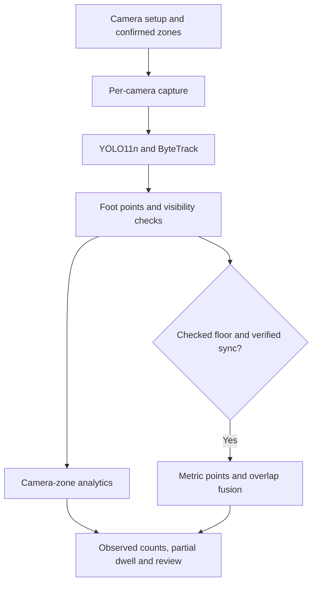

# Final deadline dataset, training and deployment architecture

Date: 2026-10-07

Project: C:\Coding\ML\Everseen

Submission window: three days, based on the stated deadline.

## 1. Decision

Build and submit a camera-zone analytics product with a progressive geometry upgrade. Use pretrained YOLO11n person detection, ByteTrack within each camera, foot-point zone assignment, short boundary persistence, observed occupancy and partial dwell, and a local setup/replay dashboard. Enable metric floor coordinates and instantaneous overlap fusion only after independent calibration checks and verified synchronization.

The geometry-first Architecture 2 decision remains valid for calibrated installations. The deployment prerequisite changes: an operator can begin with camera-local zones while calibration is prepared. No MMPTRACK dependency is needed to demonstrate this implemented path.

Training is a separate adaptation workflow: accessible human-annotated shopping footage establishes a pilot benchmark; uncertainty-ranked installation frames are corrected by a person; a lightly adapted detector is promoted only after a distinct validation session passes. Do not automatically train on high-confidence detections as if omitted people were verified background.

The selected default is the original pretrained detector at confidence 0.35. It narrowly wins validation F1. The human-annotation adaptation improves the held-out test results and is retained as a challenger. The small validation difference does not establish statistical superiority.

## 2. What was actually completed

- Downloaded ten official CAVIAR shopping-centre videos and their ten XML annotation files, with provenance and SHA256 hashes.
- Decoded the complete videos to repair misleading MPEG frame-count metadata.
- Created scenario-separated training, validation and test partitions; paired camera views stay together.
- Ran pretrained, human-annotation adaptation and uncorrected pseudo-label adaptation on real video.
- Implemented activity-region suggestions and a 48-frame review queue without using ground truth to select the suggestions or review frames.
- Compared foot points with box centres, evaluated sampled tracking and illustrative-zone occupancy, and tested zone persistence across 30 noise seeds.
- Tested four sampling cadences and exported a CPU ONNX candidate with explicit preprocessing parity checks.
- Implemented and exercised the local polygon editor, configuration save/validation, analysis action, two-video playback and partial-dwell outputs.
- Added ten contract tests covering geometry checks, ambiguity, duplicate counting, visibility gaps, matching and a bounded live-frame buffer.
- Preserved the earlier architecture experiments. This document supplements their evidence.

This is an end-to-end local prototype. Sustained production RTSP operation, unseen-store performance, complete queue wait time, and global visitor identities are not established by these experiments.

## 3. Dataset fallback and preparation

### Accessible real footage

Source: [official CAVIAR archive](https://homepages.inf.ed.ac.uk/rbf/CAVIARDATA1/).

The selected archive contains real shopping-centre footage with person boxes and track IDs, plus explicit foot annotations for some visible people. The downloaded clips are 384 x 288 at 25 fps. The archive specifies Creative Commons attribution/share-alike terms and attribution to the EC Funded CAVIAR project/IST 2001 37540; retain the archive attribution with footage and labels.

The archive warns that paired cameras may start at different times. Actual first-frame timecodes also differ. Camera filenames alone do not establish synchronization or globally shared identities. Both demonstration cameras have sync_verified=false; floor fusion is disabled.

The public calibration material provides four floor correspondences per view. Four correspondences can fit a homography exactly, but cannot independently validate it. The new prototype therefore does not advertise independently checked CAVIAR geometry. Earlier WILDTRACK geometry measurements remain separate evidence.

### Split and export

| Partition | Scenarios | Views | Decoded frames | Detector label export |
| --- | --- | ---: | ---: | ---: |
| Training | EnterExitCrossingPaths1, TwoEnterShop1 | 4 | 4,056 | 198 images |
| Validation | OneLeaveShop1 | 2 | 590 | 48 images |
| Test | EnterExitCrossingPaths2, OneShopOneWait2 | 4 | 3,894 | No training export |
| Total | Five scenarios | 10 | 8,540 | 246 labelled images |

Training export includes six early preparation samples retained and explicitly audited in training_manifest.json. Test boxes are read for evaluation only.

Full-video evaluation samples every fifth frame, approximately 5 Hz: 118 validation observations and 780 test observations. Test observations contain 2,531 person boxes. These observations are temporally correlated and come from two held-out scenarios at the same shopping centre. They do not represent 780 independent scenes, new stores or actor-disjoint splits.

Individual person objects are used; group boxes are excluded. Boxes are clipped to the image. Explicit visible, nonoccluded feet are used where available; otherwise the annotation bottom centre is a proxy. The foot-versus-centre analysis separately reports the subset with explicit human foot annotations.

### Which data answer which question?

| Data | Useful evidence | Limitation |
| --- | --- | --- |
| CAVIAR, newly run | Shopping-video detection, camera-local tracking, zone mechanisms, adaptation pilot | Old, low-resolution, sparse retail-like scenes; same site |
| Existing CITIC/EPFL/MOT work | Tracking failure cases and topology/component checks | Does not establish modern retail end-to-end accuracy |
| Existing WILDTRACK annotations | Projection, overlap geometry and fusion evidence | Outdoor calibrated setting; prior annotated-input results |
| Existing PhysicalAI experiments | Controlled downstream congestion/stress mechanisms | Synthetic/component evidence; not real retail congestion labels |
| MMPTRACK Retail | Desired retail-domain and multiview evaluation | Still unavailable; no results invented |

This combination closes the implementation and camera-zone demonstration gap. It does not replace retail deployment validation.

## 4. Detector training experiments

Both adapted models start from models/yolo11n.pt. Training uses 198 training images and 48 human-labelled validation images, six epochs, frozen first ten layers, AdamW, learning rate 0.0005, batch 8, image size 416, seed 42, CPU with four torch threads. Mosaic and mixup are disabled; mild scale, translation and horizontal flip augmentations are used.

The human-label arm uses existing official XML annotations. The word “reviewed” in filenames denotes that label arm; it does not mean that a new human annotation campaign was performed during this run.

The pseudo-label arm uses the same training images and teacher detections at confidence 0.6. Human-labelled validation data remain unchanged. One-to-one IoU >= 0.5 matching on training frames measures pseudo-label precision 1.000 and recall 0.566: 316 true positives, zero false positives and 242 omitted people. Training on those incomplete labels teaches a harmful background bias.

### Held-out results

Each model's confidence is selected from 0.15, 0.25, 0.35 and 0.50 on validation clips. The following table reports the separate test scenarios.

| Detector | Selected confidence | Detection precision | Recall | Detection F1 | Count MAE, people/sample | Sampled IDF1 | Zone occupancy MAE, people/zone/sample |
| --- | ---: | ---: | ---: | ---: | ---: | ---: | ---: |
| Pretrained baseline | 0.35 | 0.837 | 0.741 | 0.786 | 0.842 | 0.627 | 0.367 |
| Human-annotation adaptation | 0.15 | 0.882 | 0.771 | 0.823 | 0.771 | 0.716 | 0.350 |
| Uncorrected pseudo-label adaptation | 0.15 | 0.978 | 0.605 | 0.747 | 1.253 | 0.527 | 0.487 |

Human-label adaptation gains 3.7 percentage points in detection F1 and 8.9 points in sampled IDF1 on this test. This is promising pilot evidence for supervised adaptation.

Pseudo-label precision appears excellent, but recall and downstream counting worsen. Its fewer ID switches are not evidence of better identity tracking because substantially fewer people are detected.

Sampled IDF1 uses camera-local ByteTrack predictions, admissible IoU matches and per-clip identity assignment. It is not an official TrackEval/HOTA benchmark. Illustrative zones have no human department labels; their occupancy numbers assess the defined polygons, not inferred store semantics.

### Default model selection

| Candidate | Best validation detection F1 |
| --- | ---: |
| Pretrained baseline | 0.73650 |
| Human-annotation adaptation | 0.73401 |
| Pseudo-label adaptation | 0.58175 |

The selection rule is maximum validation detection F1. The baseline is the deployment default, despite the adapted model's better reported test results. The 0.00249 validation gap is a near tie from a single scenario, not a conclusive statistical result. The rule is documented after these exploratory experiments; it was not a preregistered study.

Production promotion should use a separate installation validation session and include counting, tracking and zone metrics, rather than only detector F1. Neither current model has been tested on an unseen modern store.

Raw evidence: experiments/deadline/comparison.json, comparison.csv, selection.json, training_manifest.json and training/*/weights/best.pt.

## 5. Creative preparation and usability strategies: measured decisions

| Strategy | What was implemented/tested | Finding | Decision |
| --- | --- | --- | --- |
| Existing annotated online shopping footage | Official CAVIAR acquisition and scenario split | End-to-end detection/tracking evaluation possible now | Use as fallback benchmark with explicit domain limits |
| High-confidence self-training | Train a separate detector on 198 pseudo-labelled frames | Teacher recall 56.6%; downstream F1, IDF1 and counting worse | Reject automatic promotion; labels require correction |
| Uncertainty-ranked review | Select 48 training-pool frames using weak confidence and temporal diversity | 2.125 errors/frame vs 1.501 random mean over 30 seeds | Use to prioritize annotation |
| Activity-derived zone suggestions | Smooth predicted foot-point occupancy; propose supported connected regions | Held-out point coverage 67.6% corridor, 35.6% front | Assist drawing; require naming and confirmation |
| Feet plus short persistence | Compare centres/feet and perturb annotated held-out paths | Large zone-assignment benefit; fewer false crossings under jitter | Default mechanism, adjustable after validation |
| Progressive floor calibration | Six-point fit/check, restricted validity hull, sensitivity gate and conservative fusion | Contract tests pass; no new independently checked real-world multiview trial | Optional capability with installation checks |
| Lower sampling cadence | Reuse cached real detections at 5, 2.5, 2 and 1 Hz | Lower cadence generally worsens zone/duration metrics | Tune to hardware; do not assume unchanged accuracy |
| ONNX CPU export | Equal square preprocessing on 16 validation images | All compared detections match at IoU 0.95 | Optimization candidate; full-video gate still required |
| Scripted installation walkthrough | Defined protocol below | Not collected or tested in this session | Highest-value next source of target-domain labels |
| VLM floor/department inference, arbitrary stock videos, synthetic retail rendering | Considered, not empirically run | No verified metric geometry or trustworthy zone/identity GT here | No dependency in the three-day submission |

The active-review result measures error concentration at a fixed frame budget. It does not measure human minutes saved or an adapted model trained from those 48 selected frames. The tested selector uses weak detection confidence and temporal diversity; augmentation disagreement is an optional input hook and was not exercised.

Activity suggestions cover only part of the observed walkable space. Suggested image-area fractions are about 20.8% corridor and 6.4% front. Neither point coverage nor area proves accurate department boundaries or physical floor masks. Quiet regions are easy to miss. Operators retain the final boundary and meaning.

## 6. Manual zones: resolving the actual problems

1. **Perspective and tall boxes.** Draw visible floor regions and classify by the bottom-centre foot proxy. On baseline matched observations with explicit human feet, zone accuracy is 96.12% with the predicted foot proxy versus 82.49% with predicted box centre. The adapted model scores 97.02% versus 82.41%. These percentages condition on matched tracks; missed people are excluded.
2. **Occlusion and truncated bodies.** Bottom centre is imperfect when feet are hidden. Top/bottom-truncated tracks are reported as unknown zone and excluded from floor projection. Do not infer unseen occupancy from an apparent head location.
3. **Boundary jitter.** Default persistence is 0.2 seconds and normalized margin is 0.008. Validation-only noisy trajectories selected the persistence from 0, 0.2, 0.4 and 0.8 seconds. It is time-based, not a fixed frame count.
4. **Overlapping polygons.** Equal-priority overlaps abstain, including when an existing track enters the overlap. Explicit priority can resolve intentional nesting. Invalid/self-intersecting polygons are rejected on save.
5. **Two cameras watching the same zone.** Declare shared semantic zone IDs and an owner camera. Show the owner's observed count; if it is missing, return unavailable. Without an owner, report the duplicate-uncertainty interval [maximum camera count, sum of counts]. This bounds deduplication of observed detections only, not the true population: detector misses remain possible.
6. **Visible dwell versus complete visits.** Accrue time only across consecutive reliable same-zone observations. Gaps are excluded and dwell is labelled partial. Local IDs do not establish full-store journey durations.
7. **Capacity and physical units.** Uncalibrated polygons have no square-metre density. Relative image motion is labelled body heights/s, never m/s. Physical speed becomes available only within checked calibration coverage.
8. **Browsing versus congestion.** A persistent combination of crowd count and slow movement raises an inspection cue. It cannot by itself distinguish browsing, queueing, a demonstration or a blocked aisle.

### Stability stress

Thirty noise seeds perturb real held-out annotated trajectories at normalized sigma 0.002, 0.01 and 0.03. This is a controlled point-error mechanism test, not a new detector robustness dataset.

At sigma 0.01, transition F1 rises from 0.706 without persistence to 0.882 with 0.2-second persistence. Mean false transition events fall from 23.13 to 0.43. Pointwise zone accuracy falls from 0.976 to 0.964 and duration error rises from 0.146 to 0.228 seconds because filtering delays changes.

At near-clean sigma 0.002, transition F1 is 0.954 without persistence versus 0.886 with persistence. The filter therefore trades reaction speed for stability and is not universally beneficial.

The duration metric in comparison.json is oracle-mapped observed zone-duration error: 2.919 seconds baseline, 2.855 adapted and 4.821 pseudo-label. It uses sampled observations, illustrative zones and ground-truth identity mapping for evaluation. It is not a completed visit, checkout wait or deployment forecast metric.

## 7. Final training architecture

### Immediate submission path

- Keep the pretrained detector as champion and the human-label adapted checkpoint as challenger.
- Use accessible annotated CAVIAR as a transparent shopping-video pilot.
- Keep prior WILDTRACK geometry and PhysicalAI stress evidence in separate evaluation sections.
- Train no department classifier: departments are operator configuration.
- Train no new retail ReID or congestion forecasting network from unrelated online clips.
- Preserve train/validation/test source separation, hashes, seeds, confidence selection and raw outputs.

### Installation adaptation path

1. Record 10–20 minutes from actual installed cameras across quiet, crossing, crowded and occluded conditions.
2. Select uncertain temporally diverse frames and add a coverage quota for quiet/far-field areas. The coverage quota is a recommended next step, not present in the current selector.
3. Have a person correct boxes, add every missed person and remove false boxes. Automatic prelabels alone are not a completeness guarantee.
4. Keep a different recording session/day for validation and another for final reporting. Overlapping cameras from the same physical event belong to the same split.
5. Fine-tune lightly from the pretrained model; evaluate detector recall/F1, camera-local tracking, actual zone occupancy, transitions and visible dwell.
6. Promote only if installation validation meets the operational criteria. Keep the champion and configuration version available for rollback.

A short scripted walkthrough can cheaply generate purposeful hard cases: people cross each drawn boundary, stop in each zone, partially occlude each other, traverse camera overlaps and enter/leave views. Human observers record event times and counts. For calibration, measure distributed floor points and independently held-out check points. For synchronization, align a common visible event or trustworthy capture timestamps. For queue wait validation, record true queue entry and service completion, not just slow motion.

These installation recordings were not collected in the present experiment. They are the recommended next action during the remaining deadline, subject to camera availability.

## 8. Final deployment architecture



| Layer | Implemented choice | Capability boundary |
| --- | --- | --- |
| Setup | Local FastAPI dashboard, normalized polygon canvas, suggestions, source editing, versioned saves | Adding cameras and calibration currently use advanced JSON |
| Capture | Sequential decode for files; single-slot latest-frame reader for live sources | Actual RTSP devices and prolonged reconnection not tested |
| Detector | YOLO11n pretrained, 416, CPU four threads, confidence 0.35 | Threshold validated on CAVIAR; target-site retuning needed |
| Tracking | ByteTrack per camera; low-score detections retained for association | Camera-local IDs; no global visitor identity |
| Zone engine | Foot proxy, 0.2 s persistence, 0.008 margin, overlap abstention | Image polygons; operator-provided semantic meaning |
| Geometry | Four distributed fit points plus at least two independent checks | Same flat floor; inaccurate anchors/distortion can still defeat it |
| Fusion | Checked in-hull points, verified sync, <=0.15 s pair time gap, <0.45 m pair distance, no duplicate camera per group | Instantaneous overlap observations; not complete MTMC tracking |
| Analytics | Observed occupancy, transitions, partial dwell, local speed, persistent crowd/slow cue | Complete waits and bottleneck causes unvalidated |
| Output | JSONL events, JSON summary, browser-playable overlays, local dashboard | Research prototype; no durable production event database |

Independent calibration check error defaults to at most 0.3 m, with at least two unused fit-check points. Projection is disabled outside the fit-anchor convex hull. Fusion refuses points whose approximate projection sensitivity plus check residual exceeds 0.25 m. This heuristic uncertainty estimate is not a calibrated probability distribution.

Operators must set sync_verified only after actual physical time alignment. Similar video-relative numbers do not prove simultaneous capture. The supplied demo keeps it false. No projected CAVIAR floor results are claimed.

If calibration fails, the usable fallback is camera-zone analytics and explicit ownership. Blind gaps are not filled with invented IDs. The previous topology-handoff research remains useful for a later validated implementation; the new prototype does not implement global handoff repair.

The setup server binds to loopback. Changed configurations invalidate old analytics and video results. Changing a camera source prevents proposals from the previous source. Current RTSP timestamps are local decode-receipt times, not independently verified capture times. Camera drift checks, lens correction workflow, reconnect/backoff, long-run state pruning, authentication for remote access, GPU batching and a production database are further engineering work.

## 9. Compute and cadence decision

The evaluated machine uses Python 3.12.4, torch 2.2.2 CPU, ultralytics 8.4.172, OpenCV 4.11.0.86, numpy 1.26.4, scipy 1.17.1, FastAPI 0.141.1 and uvicorn 0.52.0. No CUDA device was available.

The original two-camera 5 Hz replay processed 194 camera samples in 42.55 seconds for about 19.4 seconds of footage per camera, while other experiments also used CPU. This does not demonstrate two-camera 5 Hz real time. The final replay validation stores its own wall time in replay_validation.json.

| Sampling cadence | Sampled IDF1 | Zone occupancy MAE | Oracle-mapped observed zone-duration MAE |
| --- | ---: | ---: | ---: |
| 5 Hz | 0.627 | 0.367 people | 2.919 s |
| 2.5 Hz | 0.580 | 0.489 people | 3.794 s |
| 2 Hz | 0.640 | 0.429 people | 3.693 s |
| 1 Hz | 0.577 | 0.572 people | 5.119 s |

The 2 Hz IDF1 fluctuation is not evidence that subsampling improves identity generally. The small scenario set and changing sampled matches explain why monotonic improvement is not guaranteed. Lower cadence worsens zone occupancy and observed-duration metrics here.

For the hackathon, replay is the validated demonstration. Start live deployment with one camera and measure latency. A two-camera CPU installation may need a lower cadence with explicit accuracy tradeoffs; a GPU or properly validated optimized engine is the next scaling route.

ONNX export initially disagreed with PyTorch because rectangular and square letterboxing were different. The corrected 16-image validation uses rect=False for both: all compared detections match at IoU >= 0.95, with maximum matched coordinate difference 0.00013 pixels. Median sample times excluding warmup were 0.220 s PyTorch and 0.137 s ONNX under concurrent CPU activity.

The main video experiment uses automatic rectangular letterboxing. Consequently, square-input ONNX is not the scored deployment default. Run full validation videos with a consistent input policy before promotion. There is no blanket real-time claim based on this tiny export benchmark.

## 10. Run the implemented prototype

In PowerShell:

```powershell
Set-Location C:\Coding\ML\Everseen
.\.venv\Scripts\python.exe -m prototype.server
```

Open [http://127.0.0.1:8791](http://127.0.0.1:8791). The server is already running at completion of this work; launch only if it has stopped.

Select a camera, draw on the visible floor, name the polygon and save. Analyze 30 seconds, then inspect the two overlays and partial dwell. Use “Suggest activity regions” after analysis; accept and name useful suggestions, then save and analyze again. Removing/adding a zone changes the configuration and invalidates old results.

Camera sources are project-local video paths or RTSP/HTTP streams. Additional cameras can be added through the advanced JSON editor. For checked geometry, include normalized image_points and independently measured world_points in metres under each camera's calibration object. The first four fit the homography; later points check it. Never merely relabel an unverified source sync_verified=true.

For command-line replay:

```powershell
.\.venv\Scripts\python.exe -m prototype.run --config prototype/site.json --output experiments/deadline/demo --seconds 30
```

For the adapted challenger, edit the model path to experiments/deadline/training/reviewed/weights/best.pt and confidence to 0.15, then save and reanalyze. This does not change the documented champion choice.

## 11. Reproducibility and validation

| File/directory | Purpose |
| --- | --- |
| prototype/ | Setup UI, engine, local server, live-frame buffer and supplied site configuration |
| prototype/README.md | Quick start, supported capabilities and rerun commands |
| scripts/deadline/acquire_caviar.py | Official acquisition, hashes, complete decode and source split |
| scripts/deadline/experiment.py | Label export, inference, adaptation and metrics |
| scripts/deadline/execute_pipeline.py | Sequential adaptation evaluation with explicit exit codes |
| scripts/deadline/tune_zone.py | Validation-only persistence selection |
| scripts/deadline/validate_and_stress.py | Contracts, split audit, controlled jitter, proposals and review triage |
| scripts/deadline/cadence.py | Sampling tradeoff evaluation |
| scripts/deadline/export_cpu.py | CPU export and preprocessing parity check |
| scripts/deadline/finalize.py | Validation-based champion choice, hashes, compile/config/JSON audit |
| scripts/deadline/check_ui.py | Real Chrome polygon/save/invalid-rejection checks and screenshots |
| scripts/deadline/check_final_replay.py | UI analysis action, two-video playback, source/config invalidation |
| experiments/deadline/ | Raw predictions, metrics, weights, evidence screenshots and replay outputs |
| datasets/caviar/manifest.json | Exact clip URLs, annotation URLs, SHA256 hashes and splits |

Ten contract tests pass. Prototype and deadline scripts compile. The final audit parses all top-level experiment JSON files and validates the supplied configuration. Chrome checks exercise desktop and mobile setup, polygon addition/save/restore, self-intersection rejection, and playback. The final end-to-end check uses the selected confidence/persistence, blocks stale results, and verifies that unsynchronized demo footage produces no floor fusion.

A deterministic eight-frame held-out montage was visually inspected. It is a qualitative sample; numeric results use the full sampled test clips. MPEG frame counts were checked by sequential decoding rather than trusted container metadata. All four adaptation/evaluation pipeline subprocesses completed successfully.

Training was run with one seed. No independent-store confidence interval, human annotation-time study, official congestion ground truth, long-duration RTSP load test or retail MTMC identity score is claimed.

## 12. Remaining three-day execution plan

| Time | Work | Exit criterion |
| --- | --- | --- |
| Day 1 | Demonstrate the completed setup/replay; record an installation walkthrough if cameras are available; correct targeted labels | Reproducible demo and clearly defined actual store zones |
| Day 2 | Validate on a separate recording session; check any measured floor anchors and real synchronization; benchmark one live camera | Report target-session occupancy/transition errors and latency; enable only passed capabilities |
| Day 3 | Freeze champion/configuration, retain attribution, record submission video, package code and disclose scope | Demo launches locally, results match evidence, claims stay within tested capabilities |

If MMPTRACK arrives, use it for a new separately documented benchmark. Do not mix its frames into training and continue reporting the current test set as a fresh unbiased final assessment after repeatedly selecting against it.

## 13. Final conclusion

Manual camera polygons are an effective low-friction configuration interface when combined with feet, ambiguity handling, short persistence, visibility-aware partial dwell and explicit camera ownership. They do not require a learned department model.

The most effective new data strategy tested is accessible annotated shopping footage plus modest supervised adaptation. Uncertainty sampling is useful for finding correction-worthy frames. Raw pseudo-label retraining is ineffective in this pilot because omitted people are treated as background. Behavioral zone proposals reduce drawing effort only as suggestions; their incomplete coverage prevents automatic semantics.

Submit the implemented camera-zone prototype now. Keep geometry-first shared-floor analytics as a checked installation upgrade, retain the pretrained detector champion with a supervised challenger, and reserve stronger claims about complete waits, retail identities and bottleneck causes for target-site evaluation.
